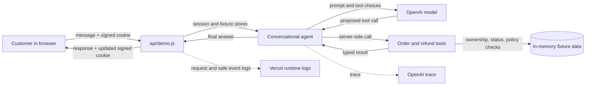

# How the example works end to end

This is a learning prototype with fictional records. The server owns the demo session and policy checks; the model proposes tool calls and writes the customer-facing reply.

## One chat request

1. The browser sends a message to `/api/demo` with its signed, HTTP-only demo cookie.
2. The server verifies that cookie and obtains the fictional persona's session. The model cannot select a customer identity for a tool call.
3. The Agents SDK sends the conversation to the configured model. The model may request an order or refund tool.
4. The server-side tool uses the verified session and applies ownership, shipping-state, address, and refund-policy checks. Refund requests can enter a pending queue for review; the customer agent has no approval tool.
5. The tool result returns to the model, which writes a response. The route returns the response to the browser and updates the signed demo state.

The model can propose an operation. It cannot make an unauthorized tool result succeed or grant itself the separately constructed human-review capability.

## Where checks run

| Check or observation | Location | Needs a live model call? |
| --- | --- | --- |
| Ownership, shipped status, PIN validation, refund eligibility | Server tools in `src/` | No |
| Unit/API behavior and grader correctness | `test/` via `pnpm test` | No |
| Deterministic refund policy scenarios | `evals/deterministic-policy-eval.js` | No |
| Model tool choice and final wording | `evals/model-eval.js` | Yes |
| Whole multi-turn refund conversation | `evals/conversation-eval.js` | Yes |
| Automated pull-request gate | `.github/workflows/ci.yml` | No; live evals are kept out of CI |

## Logs and traces

Vercel runtime logs describe the server request and safe application events. OpenAI traces show model runs, model turns, and tool spans. The application groups turn traces with a conversation ID; each submitted turn has its own trace ID. The local model eval runners call OpenAI directly and do not pass through Vercel.

## Prototype boundary

The account personas, orders, PIN directory, and delivery promises are fictional fixtures. The signed cookie is a demo session, not real authentication. The queue is not durable, the carrier is not connected, and no payment is issued. The deployed chat endpoint has no rate limit today, so do not expose it broadly without adding abuse and usage controls.
